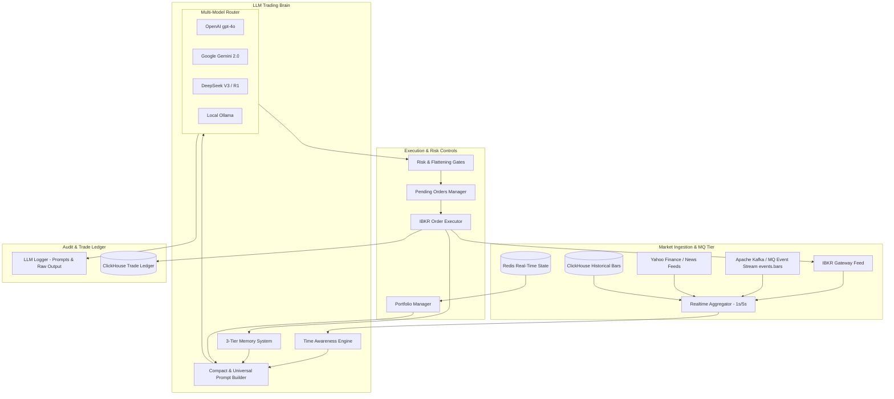

# AI Auto Trading: Autonomous Multi-LLM Quantitative Trading System

[English](README.md) | [简体中文](README_CN.md)

> **Baseline Release Notice (12-Month Open Source)**  
> This repository represents a snapshot of the foundational architecture developed over 12 months. Production deployments and commercial iterations are maintained in separate private releases. Distributed under the MIT License.

**AI Auto Trading (LLM Trader)** is a fully modular, autonomous quantitative trading system powered by multi-LLM cognitive reasoning (**OpenAI GPT-4o, Google Gemini, DeepSeek, local Ollama**). Featuring a **3-tier episodic/policy/reflection memory engine**, **market session time awareness**, **high-frequency compact prompt compression**, and **Interactive Brokers (IBKR)** direct execution, it equips LLMs with the capability to interpret market microstructure, place rational orders, and continually evolve.

---

## ✨ Key Capabilities

1. **Multi-LLM Support & Live Battle Arena (LLM Race)**
   - Out-of-the-box support for **OpenAI (GPT-4o, o1)**, **Google Gemini (2.0 Flash)**, **DeepSeek (V3, R1)**, **DeepSeek-NVIDIA**, and local self-hosted **Ollama (Qwen, Llama3)**.
   - Built-in **LLM Race Mode**: Compete multiple AI models simultaneously under identical market conditions, initial capital, and symbol universes to benchmark win rates, Sharpe ratios, and risk mitigation strategies.

2. **3-Layer Memory & Cognitive Architecture**
   - **Episodic Memory**: Tracks every order fill, entry basis, holding duration, and realized PnL.
   - **Policy Memory**: Dynamically locks in risk posture and position sizing rules refined across trading sessions.
   - **Reflection Memory**: Periodically triggers autonomous critical self-assessment after trading cycles and market close, storing structured lessons learned into an immutable trading journal.

3. **Compact Prompt Compression (83% Token Cost Reduction)**
   - Two-tier prompt architecture: High-frequency execution cycles ingest compressed numeric market microstructure, cutting token consumption by up to 83%.
   - Low-frequency reflection cycles ingest broader macro narratives and performance history, providing deep multi-step reasoning without ballooning API costs.

4. **Time Awareness & Session-Based Risk Gates**
   - Native awareness of Eastern Time (ET) market cycles (Pre-Market 04:00-09:30, RTH 09:30-16:00, After-Hours 16:00-20:00, Overnight 20:00-04:00).
   - **End-of-Day (EOD) Flattening Circuit Breakers**: Automatically halts new entries 5 minutes before close (15:55 ET) and liquidates intraday inventory to eliminate overnight gap exposure.
   - **Auto-Degrade Guard**: Enforces minimum 1m/5s bar counts before entry; enters read-only observation mode if data coverage is incomplete.

5. **Direct Broker Integration, MQ Event Streaming & Ledger Auditing**
   - Direct connection to Interactive Brokers (IBKR Gateway / TWS) with automated retry, slippage controls, take-profit/stop-loss bracket placement, and broker fill reconciliation.
   - Native integration with upstream **Apache Kafka / MQ Event Bus** (`events.bars`) and **Redis** real-time state bus, alongside **ClickHouse** audit ledgers persisting prompt inputs, raw LLM outputs, and execution fills.

---

## 🏗 System Architecture



---

## 📂 Repository Layout

```text
ai-auto-trading/
├── run_single_bot.py          # Primary CLI runner for a single LLM trading bot
├── run_llm_race.py            # CLI battle arena running multiple LLMs in parallel
├── requirements.txt           # Project dependencies
├── .env.example               # Configuration template for keys and endpoints
├── pyproject.toml             # Python packaging specification
├── LICENSE                    # MIT License
├── README.md                  # English documentation
├── README_CN.md               # Chinese documentation
├── run_all_providers.sh       # Launch all models in production paper mode
├── run_fast_providers.sh      # Launch low-latency model stack
├── run_premarket.sh           # Execute pre-market scanning and news scalping
└── llm_trader/                # Core engine package
    ├── llm_trader_bot.py      # Core trading loop orchestration
    ├── providers/             # LLM provider implementations (OpenAI, Gemini, DeepSeek, Ollama)
    ├── data/                  # Market data fetchers and cache loaders
    ├── portfolio/             # Position tracking and cash accounting
    ├── sentiment/             # Financial news and sentiment analysis pipelines
    ├── trading/               # IBKR executor and order action definitions
    ├── utils/                 # Time awareness, memory systems, prompt builders
    └── scripts/               # Helper utilities and data health checkers
```

---

## 🚀 Quick Start

### 1. Installation

Python 3.10+ recommended:

```bash
git clone https://github.com/chanaliuxing/ai-auto-trading.git
cd ai-auto-trading
pip install -r requirements.txt
pip install -e .
```

### 2. Configure Environment

Copy the `.env.example` file and configure your API keys:

```bash
cp .env.example .env
```

Populate the models you plan to use:
```env
OPENAI_API_KEY=sk-...
GEMINI_API_KEY=AIzaSy...
DEEPSEEK_API_KEY=sk-...
OLLAMA_BASE_URL=http://localhost:11434

# Trading universe & default capital
TRADING_SYMBOLS=AAPL,TSLA,NVDA,QQQ
INITIAL_CASH=50000.0
```

### 3. Run Simulated Trading (Dry-Run)

Run an autonomous bot using Google Gemini in dry-run mode:
```bash
python run_single_bot.py --provider gemini --symbols AAPL TSLA NVDA --dry-run
```

Enable V2 3-tier memory and compact prompt mode for maximum efficiency:
```bash
python run_single_bot.py \
  --provider deepseek \
  --symbols NVDA TSLA \
  --enable-v2 \
  --compact-prompt \
  --dry-run
```

### 4. Run Multi-LLM Battle Arena (LLM Race)

Benchmark OpenAI, Gemini, and DeepSeek against each other in real-time:
```bash
python run_llm_race.py \
  --providers openai gemini deepseek \
  --symbols AAPL NVDA \
  --cash 50000 \
  --interval 60
```

### 5. Live Broker Trading

> ⚠️ Live execution requires a running Interactive Brokers Gateway or TWS instance (default port `4002` for Paper, `4001` for Live). Ensure thorough dry-run validation before committing live capital.

```bash
python run_single_bot.py \
  --provider deepseek \
  --symbols QQQ SPY \
  --close-at 15:55
```

---

## 🔐 Risk Invariants & Safety Defaults

1. **Simulation Default**: The bot operates strictly in simulation unless live flags are explicitly configured.
2. **Pre-Close Liquidation**: By default, intraday positions are flattened before 16:00 ET to eliminate overnight exposure.
3. **Position Caps**: Max capital allocation per position is bounded (default 30%) with hard dollar ceilings on individual orders.

---

## 📄 License

Distributed under the [MIT License](LICENSE).  
Copyright (c) 2026 Wei Zhang
